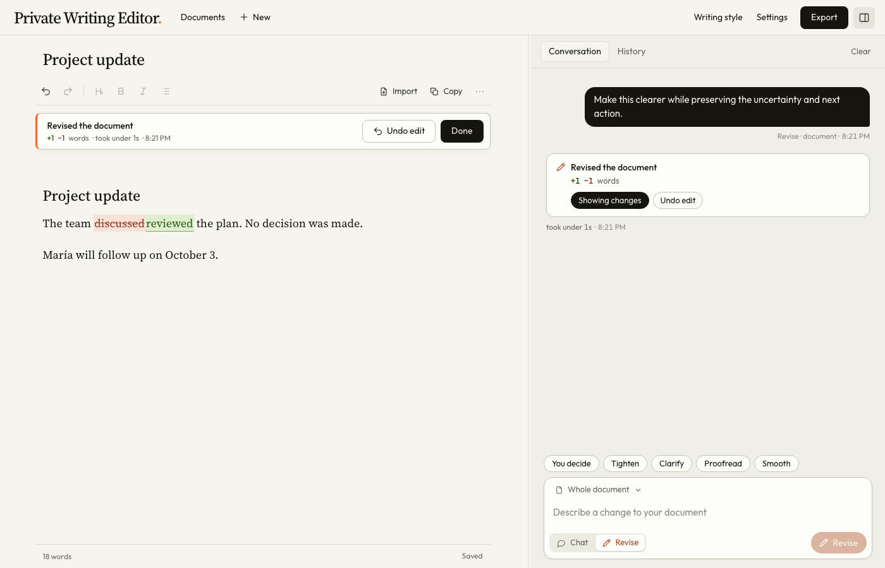

# Private Writing Editor

When you write for a living, it's hard to use AI well. The words sound artificial, the tools don't learn your voice, and your writing isn't private. Private Writing Editor runs its assistant entirely on your Mac. It takes direction from your own writing samples, shows every edit inline, and lets you undo any of them.



*The model-free preview, with fictional notes and a scripted assistant.*

## Try the editor without a model

Requires Python 3.12 or later. From this repository:

```sh
python3 -m venv .venv
source .venv/bin/activate
python -m pip install -r requirements.txt
python folio/tests/preview_server.py
```

Open `http://127.0.0.1:8770`. The preview runs on fictional notes and a scripted assistant in a temporary workspace, so you can try editing, revisions, history, and undo. Its answers are canned, so they don't show what a real model can do. Ctrl-C stops it.

Try **Revise → Clarify**, look over the highlighted changes, then choose **Undo edit**. Switch to **Chat** for a reply that leaves the document alone.

## How it works

- **The writer stays in control.** Talking about a draft and changing it are separate actions: **Chat** never edits, **Revise** does. A selected passage stays selected through follow-up edits, and every change is linked to the request that made it. See [editor.js](folio/static/editor.js) and [workspace.js](folio/static/workspace.js).
- **Model output is a proposal, never an overwrite.** Cancelling, a cut-off response, or typing while a request runs all leave your document intact. Tests cover stale responses, exact selections, undo, and failed saves. See [server.py](folio/server.py) and the [workflow tests](folio/tests/test_workflow.cjs).
- **Local means working within real limits.** A local model has a small context window, shared by the document, your examples, and the request. When a request won't fit, the editor tells you instead of quietly dropping part of your writing. The model is reached only over loopback, and its runtime is blocked from the internet. See [model_adapter.py](folio/model_adapter.py) and the [prompt tests](folio/tests/test_prompts.py).

## Run it with a local model

The full app needs an Apple Silicon Mac, Python 3.12 or later, Node.js, and [LM Studio](https://lmstudio.ai) with its `lms` CLI and `rag-v1` SDK plugin, plus a downloaded model. It's set up for a 31B six-bit Gemma model, so plan on plenty of memory and disk space. Model weights aren't included.

Configure LM Studio to match the [runtime notes](local-gemma/README.md#configuration), which document one tested setup rather than installing anything. Then, with the Python dependencies above installed:

```sh
./'Open Private Writing Editor.command'
```

For a native window, run `./'Build Private Writing Editor.command'` and open the generated `Private Writing Editor.app` (Xcode Command Line Tools required). The app runs from this checkout, so rebuild it after moving the folder or changing Python. This is a source project, not a packaged installer.

## Tests

```sh
python -m unittest discover -s folio/tests -v
python -m unittest discover -s tests -v
python -m unittest discover -s local-gemma/tests -v
node --test folio/tests/test_frontend_state.cjs
```

The browser suites need a few extra test dependencies:

```sh
npm ci
npx playwright install chromium webkit
npm run test:browser
```

They run on fictional writing with a scripted assistant and check that documents survive imports, exports, failed saves, revisions, locks, and quitting. They test the editor, not model quality.

## Privacy and limits

Private Writing Editor has no cloud AI, analytics, or tracking, and its interface loads nothing from the internet. Your writing lives in `folio/private/`, which Git ignores. The editor doesn't encrypt those files, so your Mac's own protections and backup settings apply. Installing dependencies and downloading models do use the network.

DOCX and PDF imports bring in the text only, with no OCR and no original layout. Word export creates a clean new document. The [Word adapter](local-gemma/README-word.md) is a narrow proof of concept that edits single plain-text paragraphs.

The [user guide](docs/GUIDE.md) covers the full editing workflow, storage, the launchers, and troubleshooting. Font licenses are in [folio/static/fonts](folio/static/fonts).
